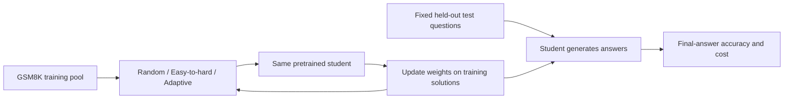
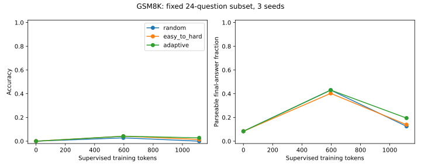
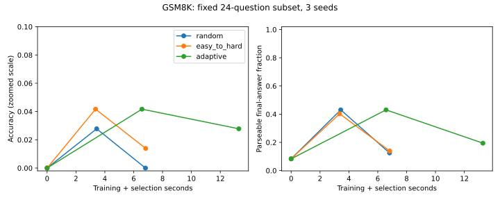
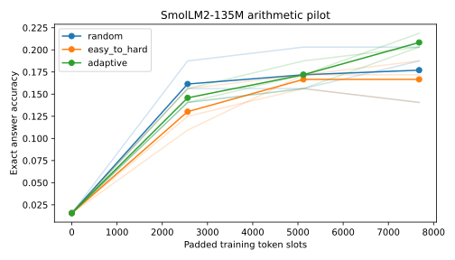
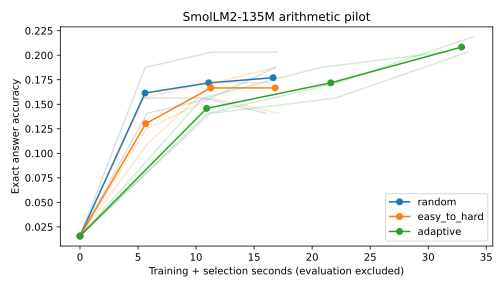
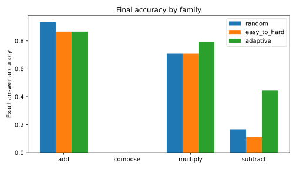
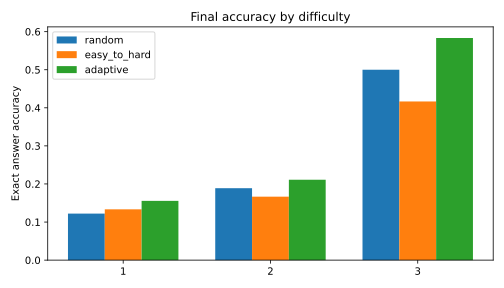
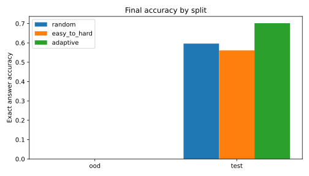

# Historical pipeline experiments

These earlier studies validate the experiment pipeline. They do not establish AMC reasoning gains and use a different student from the current AMC calibration.

The two arithmetic runs used byte-identical datasets. The shared copy is now `results_full/data.json`; `results/dataset_reference.json` records its location and SHA-256, verified by `validate_results.py`. All unique predictions, selections and run metadata are retained.

## Historical evidence

<details>
<summary>GSM8K pilot — expand measured results and reproducible method</summary>

## Historical GSM8K pilot

**The fixed-subset GSM8K experiment is complete: nine actual training runs, three seeds and 456 saved evaluation responses.**

Research question: with the same initial model and training-token budget, should the next example be selected randomly, from easy to hard, or using the student's current errors? The student is **SmolLM2-135M**; each policy is a data-selection rule. The model generates answers, the training program updates weights using training solutions, and the test set is used only for scoring.



GSM8K has 7,473 official training and 1,319 official test problems. This CPU study used a fixed **24-question test subset**, a **360-question retained training pool**, 12 updates and three seeds, with complete worked-solution supervision. Both supervised token counts and padded training slots match across policies within each seed. [Exact experiment definition and provenance](GSM8K_METHOD.md).

| GSM8K subset | Final accuracy | Correct / 24 by seed | Train seconds | Select seconds |
|---|---:|---|---:|---:|
| Untrained base | 0.0% | 0 (evaluated once) | — | — |
| Random | 0.0% | 0, 0, 0 | 6.82 | 0.0002 |
| Easy-to-hard | 1.4% | 0, 0, 1 | 6.83 | 0.0002 |
| Adaptive | 2.8% | 1, 1, 0 | 6.88 | 6.41 |

**Conclusion: this small model, short training run and generation budget did not establish a reliable improvement in word-problem reasoning.** Adaptive selection produced two more final-number matches than random selection but used approximately **1.95 times** the training-plus-selection time. This does not establish a winner. **95.8%–97.2%** of final responses reached the 96-token ceiling, and some matched numbers accompanied incorrect reasoning. The metric is final-number agreement, not reasoning correctness or a full GSM8K score.

The same 24 questions are reused across seeds; 72 final observations are not 72 independent questions. Token budgets per seed are **958 / 1,165 / 1,221 supervised tokens**, identical across policies; every run also uses **3,072 padded slots**. Times are per-run seed means, excluding evaluation. [Full measured table](gsm8k_results/RESULTS.md), [raw predictions](gsm8k_results/predictions.json), [selection logs](gsm8k_results/selections.json), [evaluation timing](gsm8k_results/costs.json), [provenance and fixed IDs](gsm8k_results/manifest.json).




The answer-format fraction in the charts indicates whether responses contain parseable final answers; it does not measure reasoning ability. All charts are regenerated from saved predictions, using the corrected strict final-answer parser. Five tests passed at the GSM8K milestone; the benchmark audit checks all 456 predictions, complete test checkpoints, training-only selections, and exact matched token schedules. Unknown pretraining overlap with GSM8K and semantic duplicates cannot be excluded.

```bash
HF_HOME="$PWD/work/hf" python gsm8k.py
python -m unittest -v
python gsm8k_report.py
```

Next scientific step: select a more capable student and a longer generation/training budget using a validation split carved from training data, then freeze a new experiment before evaluating. This run used CPU only and incurred no paid cloud charges. It demonstrates a working standard-dataset experiment and its limitations, rather than a successful curriculum method.

</details>

<details>
<summary>Arithmetic pilot — expand measured results and reproducible method</summary>

## Earlier arithmetic pilot

**Status: completed — 9 real open-model training runs, 3 seeds, saved predictions and reproducible figures.**

If a model has time to study only a few examples, which examples should it study?
This project compares random examples, examples ordered from easy to hard, and examples chosen using the student's current answer loss.

We fine-tuned **SmolLM2-135M**, a public 135-million-parameter language model, on CPU for 30 updates per policy with seeds 7, 19 and 41. Adaptive selection had the highest average answer accuracy, but used almost twice the training-plus-selection time. **None of the policies solved a held-out composition problem.** This small arithmetic experiment offers no evidence of improved transfer to new reasoning families.

| Policy | Mean accuracy | Correct by seed (out of 64) | Training seconds | Selection seconds |
|---|---:|---|---:|---:|
| Random | 17.7% | 12, 9, 13 | 16.64 | 0.001 |
| Easy-to-hard | 16.7% | 12, 11, 9 | 16.81 | 0.001 |
| Adaptive | 20.8% | 13, 13, 14 | 17.21 | 15.66 |

Times are means over three runs. All start at **1/64 (1.6%)**. Evaluation uses the same 64 problems for every run: 19 held-out questions from seen families and 45 unseen composition questions. Final seen-family accuracy is 59.6%, 56.1%, and 70.2% respectively; composition accuracy is **0% for all three**. The 3.1 percentage-point adaptive gain over random is small and measured on one fixed test set; no statistical superiority claim is made.







Bold curves show seed means; faint curves show individual runs. All figures derive from [saved predictions](results_full/metrics.json), with [summary measurements](results_full/summary.json), [selection logs](results_full/selections.json) and [environment details](results_full/environment.json). The earlier 10-step single-seed pilot remains in `results/` (random 14.1%, easy-to-hard 12.5%, adaptive 15.6%).

## What actually happened

1. Generate 800 unique arithmetic questions with exact answers: addition, subtraction, multiplication, and a held-out composition family. Save every question in `results_full/data.json`: 485 training, 115 seen-family held-out and 200 composition questions.
2. Split seen families by SHA-256 of the prompt (roughly 80% training). Reserve every composition problem for evaluation. Select a fixed 64-question evaluation sample before training.
3. Reload identical pretrained weights and reset the random seed for each policy. Use AdamW, learning rate 0.00002, batch size 8, and padded length 32.
4. Random: sample 32 training candidates and use eight. Easy-to-hard: choose eight candidates nearest the scheduled difficulty. Adaptive: score 32 training candidates and prefer losses nearest 1.5 nats, a fixed heuristic for examples the student may learn from. Evaluation answers never influence selection.
5. Train on answer tokens only. Evaluate greedy generation with strict exact answer matching at step 0 and every 10 updates. Save individual predictions and selected example IDs.
6. Plot saved measurements using `report.py`. Selection/scoring time is added to training time in the cost curve. Generation and evaluation are recorded separately in environment metadata.

Each final run uses **7,680 padded token slots**, including padding and prompt positions. Actual supervised answer-token means are 914.7 (random), 960.0 (easy-to-hard) and 900.0 (adaptive); this is equal tensor-compute budget, not exact equal non-padding token count. Timing is local elapsed time, not dollars or energy. Adaptive's training-plus-selection cost is 32.87 seconds versus 16.64 for random (**1.98×**). Evaluation and setup are excluded from this cost comparison.

## Run it

```bash
python3 -m venv .venv
source .venv/bin/activate
pip install -r requirements-lock.txt
python -m unittest -v
python validate_results.py results
python experiment.py --steps 10 --seeds 7 --output results
python report.py results
# Larger replication (more time):
python experiment.py --steps 30 --seeds 7 19 41 --output results_full
python report.py results_full
python validate_results.py results_full
```

The model downloads from Hugging Face; no paid APIs are used. CPU fallback and Apple MPS are supported; the measured runs used CPU on macOS ARM64 with four Torch threads. `environment.json` records the model revision, device, framework, configuration and evaluation IDs. `requirements-lock.txt` captures the measured environment. The model revision is pinned by default; override `--revision` when using a different `--model`. See [METHODS.md](METHODS.md) for the full experimental record.

## How much does this tell us?

This is an arithmetic engineering pilot, with actual pretrained-model fine-tuning. It does not measure advanced mathematical reasoning. Thirty updates, three seeds, 64 questions and a very small model give limited statistical power. Strict formatting may reject numerically correct continuations. The unseen family uses familiar operations; it is a narrow transfer test. Prompt deduplication prevents exact split overlap; semantically related arithmetic and overlap with unknown pretraining data remain possible. Difficulty is a declared operand/operator heuristic, not a validated human rating. Full-model checkpoints are not uploaded; rerun commands reproduce training. Two data tests and a saved-run audit verify arithmetic answers, stable splits, unique IDs, identical initial predictions, complete checkpoints, equal padded budgets and training-only selections. The final audit covers **2,304 saved predictions**.

</details>

## Research context

[DART-Math](https://arxiv.org/abs/2407.13690) allocates more synthesis trials to difficult problems. This project instead studies selection from a fixed arithmetic pool and charges for student scoring. It is a small reproducible comparison, with no novelty claim. [SmolLM2 model card](https://huggingface.co/HuggingFaceTB/SmolLM2-135M) documents the public model and its Apache-2.0 license. Generated arithmetic data and code here use the MIT license.
