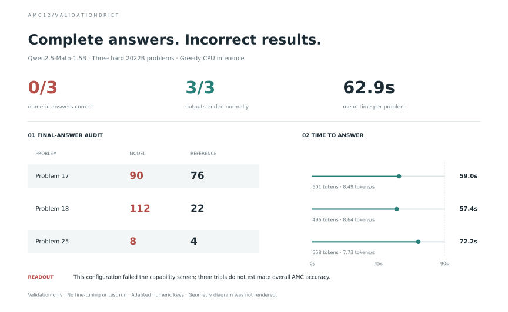

# What should a reasoning model learn next?

[](https://github.com/sonic-1108/reasoning-curriculum-lab/actions/workflows/tests.yml)

**Question:** Which examples help a reasoning model learn most under the same training-token budget?

**Initial result:** Qwen2.5-Math-1.5B-Instruct scored **0/3** on a small hard-AMC validation sample. All three outputs completed normally. No AMC training, final-test evaluation or curriculum comparison has been run.

**Active follow-up:** two pinned 4-bit students, Qwen3-4B-Instruct and DeepSeek-R1-Distill-Qwen-7B, are being screened on the same three validation questions. [Frozen configuration and limitations](MODEL_COMPARISON.md). No new-candidate accuracy is claimed until its run completes.

## Which question types worked best?

| Question type | What was tested | Correct / attempted | Accuracy |
|---|---|---:|---:|
| Counting / combinatorics | Binary arrays and grid-update configurations | 0/2 | 0% |
| Geometry | Area of a square-and-hexagon configuration | 0/1 | 0% |

**No best or worst category is established.** Both observed categories scored zero. Two counting examples and one geometry example cannot support a ranking; other categories remain untested. The geometry diagram was not rendered, so its result also has an input limitation. Categories were manually assigned after the run for descriptive reporting, not used to choose training data.



[Per-problem results](amc_results/RESULTS.md) · [Numeric predictions](amc_results/calibration.json) · [Category annotations](amc_results/problem_types.json) · [Generated category summary](amc_results/type_summary.json)

## Data and setup

- **Source:** [AI-MO AMC validation dataset](https://huggingface.co/datasets/AI-MO/aimo-validation-amc), 83 integer-answer adaptations of 2022/2023 AMC12 problems, not original multiple-choice papers or AIME.
- **Hard subset:** original positions 16–25 only. There are 9 training candidates from 2022A, 9 validation problems from 2022B, and 13 reserved test problems from 2023.
- **Actual evaluation:** three validation problems chosen beforehand by question hash. Greedy CPU inference; at most 2,048 new tokens and 90 seconds per answer. Observed times: 57–72 seconds.
- **Labels and limitations:** publisher-provided numeric keys, no worked solutions. Unknown pretraining overlap; no overall AMC accuracy claim. Problem text stays local because underlying redistribution rights are not independently established.

The three evaluated keys have now been independently checked: finite enumeration for counting and exact area from the supplied geometry coordinates. All agree with the dataset. This does not verify the other source keys or the original diagram transcription. [Verification record](amc_results/answer_verification.json) · [Solver code](verify_amc.py).

[Exact provenance and method](AMC_STUDY.md) · [Split manifest](amc_results/manifest.json) · [Study overview](amc_results/overview.svg)

## Reproduce

```bash
python3 -m venv .venv
source .venv/bin/activate
pip install -r requirements-amc.txt
python -m unittest -v
python amc_report.py       # Audit and redraw saved results; no model run
python plot_overview.py    # Redraw the study map from saved records
```

| Core code | Purpose |
|---|---|
| [amc.py](amc.py) | Acquire data locally and run the pinned math model |
| [amc_analysis.py](amc_analysis.py) | Validate annotations and compute per-type denominators |
| [amc_report.py](amc_report.py), [plot_overview.py](plot_overview.py), [figure_style.py](figure_style.py) | Reproduce reports and figures from saved evidence |

## What remains?

Validate a more capable student and obtain a larger pool of trustworthy training solutions before comparing random, easy-to-hard and adaptive selection. Keep initial weights and supervised-token budgets matched; account for scoring costs separately. The main research question remains unanswered.

## Historical evidence

[Earlier GSM8K and arithmetic pilots](HISTORICAL_RESULTS.md) are archived separately with their methods and raw measurements. They used a different, smaller student and do not establish AMC improvements. One duplicate arithmetic dataset was replaced with an explicit checksum-verified reference; unique experimental records remain intact.

Code uses the [MIT license](LICENSE). Dataset and model rights are described in the [study method](AMC_STUDY.md).
