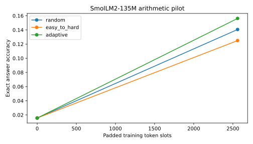
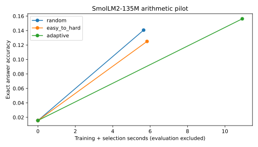
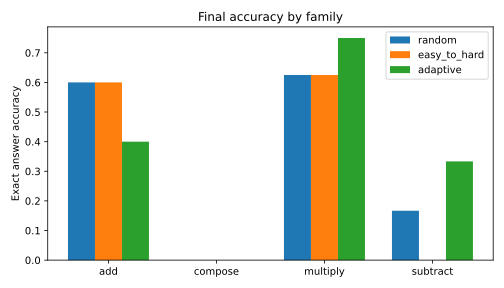
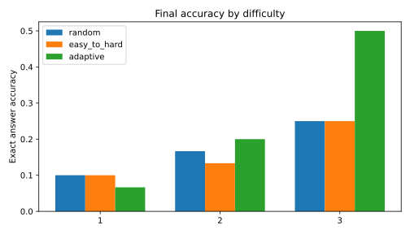

# What should a reasoning model learn next?

**Status: real open-model arithmetic pilot completed; larger three-seed run in progress.**

If a model has time to study only a few examples, which examples should it study?
This project compares random examples, examples ordered from easy to hard, and examples chosen using the student's current answer loss.

The first run fine-tuned **SmolLM2-135M**, a public 135-million-parameter language model, locally for 10 updates per policy. On the same 64 held-out problems, random selection solved **9/64 (14.1%)**, easy-to-hard solved **8/64 (12.5%)**, and adaptive selection solved **10/64 (15.6%)**. These small differences from one seed do **not** establish a winner.






## What actually happened

1. Generate 800 unique arithmetic questions with exact answers: addition, subtraction, multiplication, and a held-out composition family. Save every question in `results/data.json`.
2. Split seen families by SHA-256 of the prompt (roughly 80% training). Reserve every composition problem for evaluation. Select a fixed 64-question evaluation sample before training.
3. Reload identical pretrained weights and reset the random seed for each policy. Use AdamW, learning rate 0.00002, batch size 8, and padded length 32.
4. Random: sample 32 training candidates and use eight. Easy-to-hard: choose eight candidates nearest the scheduled difficulty. Adaptive: score 32 training candidates and prefer losses nearest 1.5 nats, a fixed heuristic for examples the student may learn from. Evaluation answers never influence selection.
5. Train on answer tokens only. Evaluate greedy generation with strict exact answer matching at step 0 and every 10 updates. Save individual predictions and selected example IDs.
6. Plot saved measurements using `report.py`. Selection/scoring time is added to training time in the cost curve. Generation and evaluation are recorded separately in environment metadata.

Each pilot policy uses **2,560 padded token slots**, including padding and prompt positions. Actual supervised answer-token totals differ and are reported in `summary.json`; this is equal tensor-compute budget, not exact equal non-padding token count. Timing is local elapsed time, not dollars or energy.

## Run it

```bash
python3 -m venv .venv
source .venv/bin/activate
pip install -r requirements-lock.txt
python -m unittest -v
python experiment.py --steps 10 --seeds 7 --output results
python report.py results
# Larger replication (more time):
python experiment.py --steps 30 --seeds 7 19 41 --output results_full
python report.py results_full
```

The model downloads from Hugging Face; no paid APIs are used. CPU fallback and Apple MPS are supported. `environment.json` records the model revision, device, framework, configuration and evaluation IDs. `requirements-lock.txt` captures the measured environment. Default model revision can evolve: use the saved revision when reproducing historical results.

## How much does this tell us?

This is an arithmetic engineering pilot, with actual pretrained-model fine-tuning. It does not measure advanced mathematical reasoning. Ten updates, one seed, 64 questions and a very small model give limited statistical power. Strict formatting may reject numerically correct continuations. The unseen family uses familiar operations; it is a narrow transfer test. Prompt deduplication prevents exact split overlap; semantically related arithmetic and overlap with unknown pretraining data remain possible. Difficulty is a declared operand/operator heuristic, not a validated human rating. Full-model checkpoints are not uploaded; rerun commands reproduce training.

## Research context

[DART-Math](https://arxiv.org/abs/2407.13690) allocates more synthesis trials to difficult problems. This project instead studies selection from a fixed arithmetic pool and charges for student scoring. It is a small reproducible comparison, with no novelty claim. [SmolLM2 model card](https://huggingface.co/HuggingFaceTB/SmolLM2-135M) documents the public model and its Apache-2.0 license. Generated arithmetic data and code here use the MIT license.
